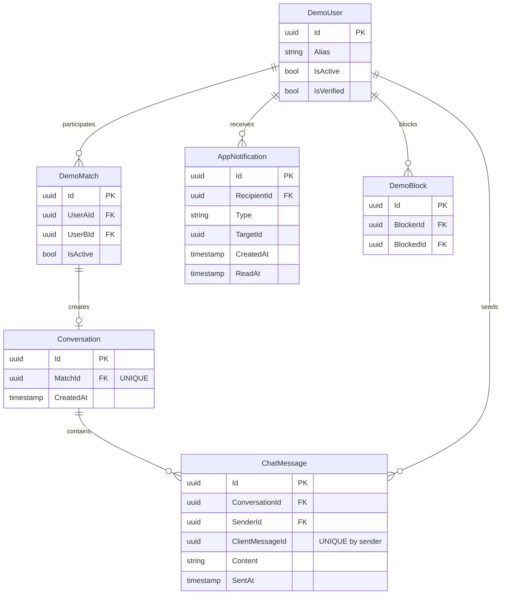
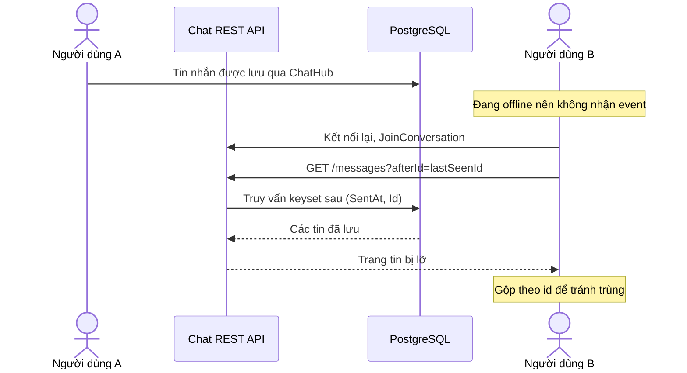

# Mô hình thiết kế module ChatNotifications — TV4

Các hình Mermaid bên dưới là **mô hình thiết kế tham khảo**, dựa trên kế hoạch nhóm. Khi ghép database thật, thay `DemoUser`, `DemoMatch`, `DemoBlock` bằng bảng TV1, TV3, TV5; không tạo các bảng demo trong production.

## 1. ERD module



## 2. Trình tự gửi tin nhắn realtime

```mermaid
sequenceDiagram
    actor A as Người dùng A (React)
    participant H as ChatHub
    participant S as ChatService
    participant P as ChatPermissions
    participant DB as PostgreSQL
    actor B as Người dùng B (React)
    A->>H: SendMessage(conversationId, content, clientMessageId)
    H->>S: SendMessageAsync(...)
    S->>P: check A/B active + match + block
    P-->>S: allowed / forbidden
    alt Allowed
      S->>DB: BEGIN; INSERT message + notification
      DB-->>S: success
      S->>DB: COMMIT
      S-->>H: MessageDto
      H-->>A: ACK (return value)
      H-->>B: MessageCreated + NotificationCreated
    else Forbidden
      S-->>H: 403 / error
      H-->>A: HubException
    end
```

## 3. Trình tự hồi phục sau mất mạng



## 4. Ràng buộc cần trình bày

- `Unique(Conversation.MatchId)`: một match không tạo hai hội thoại.
- `Unique(Message.SenderId, Message.ClientMessageId)`: client retry không tạo tin trùng.
- `Index(Message.ConversationId, Message.SentAt, Message.Id)`: tải lịch sử theo cursor hiệu quả.
- `Index(Notification.RecipientId, Notification.ReadAt)`: tải/đếm thông báo theo người nhận.
- API không nhận `SenderId` tùy ý: đọc từ JWT.
- Group SignalR chỉ tối ưu phân phối/hiện diện; kiểm tra quyền nằm ở server.
